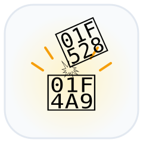
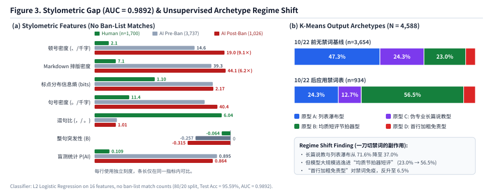

<p align="center">
  
</p>

<h1 align="center">natural-tech-zh</h1>

<p align="center">
  <strong>锤掉中文技术写作里的 AI-Slop —— 基于 23,769 条真实会话统计的外挂 Skill 与离线文体审计工具</strong>
</p>

<p align="center">
  <code>Agent Skills Compatible</code> · <code>Corpus: 23,769 Messages</code> · <code>Blind Classifier AUC: 0.9892</code> · <code>Verified: GPT-6.2-Sol</code> · <code>MIT</code>
</p>

`natural-tech-zh` 是一套面向中文开发者的外挂 Agent Skill 与离线文体审计工具，兼容 OpenAI Codex（Desktop / CLI）、Claude Code 及其他支持开放 [Agent Skills](https://developers.openai.com/api/docs/guides/tools-skills) 规范的工具。

它解决的核心问题是：**在不影响模型推理与排错准确率、不增加在线延迟、也不把回复逼进另一种固定模板的前提下，把中文技术汇报、PR 描述与文档里的 AI-Slop 压到最低。**

## 1. 为什么传统“去 AI 味禁词表”治标不治本？（实证研究）

在设计这个 Skill 之前，我们对同一套本地 Codex 历史语料做了 9 个月跨度（2026-02 至 2026-11）的定量文体学分析，样本涵盖 **371 个会话、23,769 条中文 Agent 回复（含 4,858 条最终交付回复）** 以及同一语境下的 **1,700 条真人消息基线**。

数据显示，AI-Slop 并不是几个肉眼可见的“口癖词”，而是由**词表层、宏观波形层、底层信息论/标点节律层**三层共同咬合的统计学现象。

### 1.1 打地鼠迁移效应：词表清零，排版与标点反弹

2026 年 10 月 22 日在系统指令中上线传统中文禁词表后，全量词表口癖率确实从峰值 **30.3%** 断崖跌至 **5.2%**（`不是…而是` -98.8%、`不等于/不代表` -98.4%、`你说得对` -100%）。但拆开看结构与排版指标，却出现了明显的**迁移反弹**：

- **顿号连珠密度（`、`/千字）**：从 `14.6` 逆势上涨到 **`19.0`（+29.9%，真人基线的 9.1 倍）**；
- **首行加粗判词（`**...**`）**：尽管明文禁止，仍从 `5.13%` 反弹至 **`5.88%`（+14.6%）**；
- **Markdown 排版密度**：从 `39.3` 上涨到 **`44.1 / 千字`（+12.2%，真人基线的 6.2 倍）**；
- **伪专业工程黑话**（`对齐、边界、链路、侧、兜底、收敛、闭环`）：仍残留在 **`17.5%`** 的最终回复中。


> **Figure 1.** (a) 2026 年 2–11 月全量口癖命中率与千字密度演化；(b) 10 月 22 日禁词表上线前后 `final_answer` 各指标相对变化（n_pre = 3,804, n_post = 1,054）。绿色为被压平的表层词癖，红色为逆势反弹的结构与排版习惯。

### 1.2 全篇隐形波形与多轮累积诅咒（Repeat Curse）

把 4,065 条完整回复（≥150 字）按字符进度切成 10 等分（0% → 100%），会看到一条几乎锁死的**四幕剧波形**：

1. **0–10% 开篇立威峰**：`41.0%` 顶着加粗开场，否定对比（`5.7%`，中段的 2.85 倍）与伪专业黑话（`7.9%`）同步冲顶；
2. **10–60% 中段列表瀑布**：列表占比升至 `49.2%`，条目数集中在 **3 项（1,907 次）与 4 项（1,894 次）**，内部字数变异系数均值仅 `CV = 0.327`（机械等长的“完美矩形”）；
3. **70–100% 尾部分号压缩**：分号 `；` 密度从开篇 `9.0%` 单调攀升至结尾 **`20.7%`（2.3 倍）**；
4. **90–100% 免责翘尾与黑话回潮**：免责/揽活在最后 10% 垂直跳升 **15 倍**（`0.2% → 3.0%`），伪专业黑话重新翘尾回到 `7.7%`。

同时，在无规则干预基线（n = 3,804）中，随着对话轮次拉长，口癖率从 Turn 2–3 的 `22.2%` 攀升至 Turn 21+ 的 **`32.1%`**，单条平均命中数上涨 **`+79.6%`**（`0.309 → 0.555`），复现了 [Wu et al. (2026)](https://arxiv.org/html/2604.19139v2) 报道的多轮 VTI 累积效应。


> **Figure 2.** (a) 4,065 条完整回复的 0%–100% 标准化位置解剖曲线；(b) 多轮对话中口癖比例与单条命中密度的累积趋势（Turn 7–10 尽管比 Turn 1 更短，口癖率反而更高）。

### 1.3 不用禁词命中的盲测分类器（AUC = 0.9892）与原型逃逸

为了捕捉“说不出来但一眼就能闻出的 AI 味”，我们用 **16 个文体统计特征**训练了一个 L2 逻辑回归分类器，区分真人消息（n = 1,700）与模型最终回复（n = 4,763），测试集准确率达到 **95.59%（AUC = 0.9892）**。特征包含虚化动词密度，不使用禁词表或黑话词典的命中数。

把 10 月 22 日前后的回复送进这个盲测分类器，平均 AI 概率仅从 **`0.895` 降到 `0.864`**（真人基线为 **`0.109`**）。核心鸿沟藏在三项底层特征里：
- **逗句比反转**：真人 `6.04 : 1`（一口气用逗号连贯说完），模型 `1.01 : 1`（短句号机关枪点射，标点熵 `2.17` vs 真人 `1.10`）；
- **节律均质化**：整句突发性 Burstiness 从禁词前的 `-0.257` 进一步滑向 `-0.315`（真人 `-0.064`），15 维无监督 K-Means 聚类显示，禁词表虽然把“列表瀑布 + 伪专业长篇说教”从 `71.6%` 压到了 `37.0%`，却把模型大规模挤进了**“均质短评节拍器型”（`23.0% → 56.5%`）**。



> **Figure 3.** (a) 真人与禁词表上线前后 AI 回复的文体统计对比，每项指标单独定标；(b) 15 维无监督 K-Means 聚类的四大输出原型在 10 月 22 日前后的占比迁移。

## 2. GPT-6.2-Sol 真机对照实验：为什么我们放弃了“在线强门禁”？

在隔离环境中，我们用 `GPT-6.2-Sol` 跑了两轮真机并行子 Agent 对照实验，直接暴露了 **Goodhart 定律** 陷阱：

| 实验组（GPT-6.2-Sol 真机实测） | 盲测 P(AI) | 逗句比 | 顿号 / 千字 | 标点熵 | 事实保真 | 实际人工盲读与性能评估 |
| :--- | :---: | :---: | :---: | :---: | :---: | :--- |
| **A · 常规技术助理风格** | 0.8662 | 1.41 | 13.82 | 1.859 | 100% | 典型列表与书面总结腔 |
| **B · 仅传统禁词表** | 0.6591 | 1.67 | **17.70** | 1.561 | 100% | 黑话清零，但顿号密度飙到最高 |
| **C · 在线强统计门禁循环** | **0.0872** | **5.20** | 1.42 | 0.735 | 100% | **触发 Goodhart 刷分**：把正常句号全改成逗号（一逗到底），拖慢延迟 |
| **D · `natural-tech-zh` (v2)** | 离线抽检 | 自适应 | 低 | 自适应 | **100%** | **单次出稿零延迟**：短文自然分段、动作落地；复杂对比保留表格；硬核异步排错准确率无损 |


> **Figure 4.** (a) `GPT-6.2-Sol` 三组并行子 Agent 的盲测统计结果，展示 C 组虽刷低了 P(AI) 却引发一逗到底过拟合；(b) 自然度与执行开销的定性示意图，点的位置不表示实测延迟或评分。 `natural-tech-zh` (v2) 采用单次出稿、体裁自适应和可选离线审计。

## 3. 架构与目录结构

基于上述实验，本项目采用**在线极简自适应 + 离线确定性审计**的解耦设计：

```text
unslop-zh/
├── README.md
├── LICENSE
├── assets/
│   ├── logo.svg
│   ├── fig1_intervention_displacement.svg
│   ├── fig2_macro_waveform_and_archetypes.svg
│   ├── fig3_stylometric_gap_human_vs_ai.svg
│   └── fig4_goodhart_ab_experiment.svg
└── natural-tech-zh/
    ├── SKILL.md                    # 核心体裁自适应写作与改写规则（按需加载）
    ├── references/
    │   └── jargon-map.md           # 高频伪专业黑话降维对照表
    └── scripts/
        ├── tic_lint.py             # 离线 16 维文体体检脚本
        └── model_params.json       # 冻结的盲测分类器权重
```

## 4. 快速上手

### 安装 Skill

把 `natural-tech-zh/` 放进你的用户技能目录（如 `~/.codex/skills/natural-tech-zh/`），或通过开放 Agent Skills CLI 安装：

```bash
npx skills add alanmacX/unslop-zh --skill natural-tech-zh -a codex
```

### 配合 `model-instructions.md` / `AGENTS.md` 使用

为了保证日常写代码和排错零延迟、不掉推理性能，推荐分层配合：
- **日常编码与调试**：不加载本 Skill，仅靠精简的全局底线（首行纯文本不加粗、不加常识免责尾巴、事实与纠错永远优先）。
- **面向人的汇报、文档、PR 描述**：按需触发 `natural-tech-zh`（或在提示中显式写 `$natural-tech-zh`）。

### 离线体检脚本（仅用于审计，不放进在线回复循环）

对任意长文档、PR 草稿或导出的历史回复运行统计诊断：

```bash
python3 natural-tech-zh/scripts/tic_lint.py path/to/draft.md
# 或通过 stdin
cat draft.md | python3 natural-tech-zh/scripts/tic_lint.py
```

输出包含盲测 `p_ai`、逗句比、顿号密度、标点信息熵、Markdown 排版密度、伪专业词命中数与具体告警列表，适合按月回扫历史会话监控是否出现新的口癖迁移。

## 5. 学术与开源参考

- Wu et al. (2026), [The Rise of Verbal Tics in Large Language Models](https://arxiv.org/html/2604.19139v2) — 口癖指数（VTI）、对齐税与多轮累积效应
- Zhang et al. (2025), [Verbalized Sampling: How to Mitigate Mode Collapse and Unlock LLM Diversity](https://arxiv.org/html/2510.01171v3) — RLHF 典型性偏差导致模式坍缩的理论分析
- [Negation: A Pink Elephant in the Large Language Models' Room? (2025)](https://arxiv.org/html/2503.22395v2) — 否定指令盲区与粉红大象效应
- [Large Language Models and the Normalization of Personal Narrative (2026)](https://arxiv.org/pdf/2604.22142) — LLM 改写导致的抽离口吻与抽象压缩漂移
- [blader/humanizer](https://github.com/blader/humanizer/blob/main/SKILL.md) 与 [LifelongLazyLearner/qu-ai-wei](https://github.com/LifelongLazyLearner/qu-ai-wei) — 英文与简体中文去 AI 味 Skill 工程实践

## License

[MIT](LICENSE)
