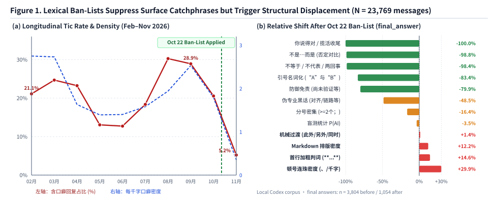
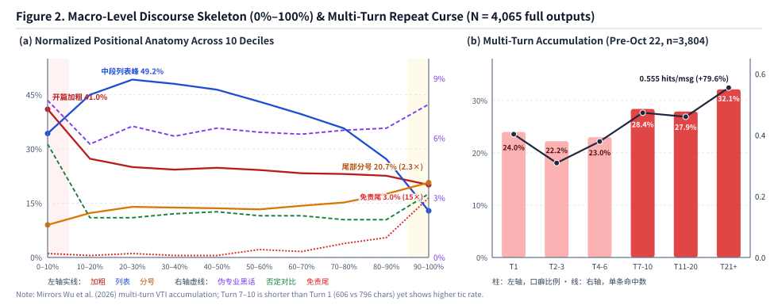
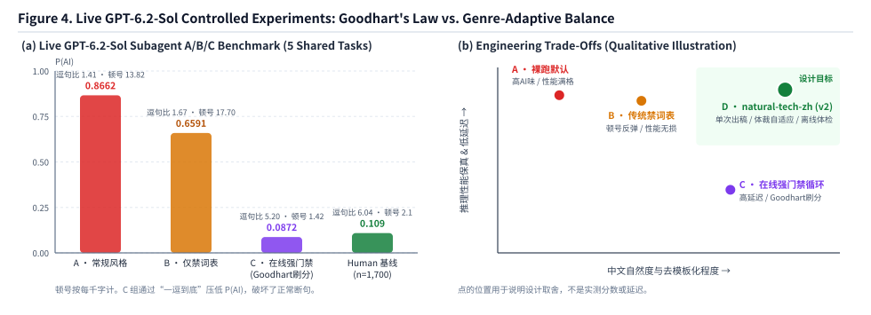

<p align="center">
  
</p>

<h1 align="center">natural-tech-zh</h1>

<p align="center">
  让大模型用正常的中文逻辑写技术内容（Agent Skill 与离线检查脚本）
</p>

`natural-tech-zh` 是一个面向中文开发者的 Agent Skill，兼容 OpenAI Codex、Claude Code 等支持 [Agent Skills](https://developers.openai.com/api/docs/guides/tools-skills) 规范的工具，用来去掉中文技术回复、PR 描述和设计文档里的英文翻译腔与 AI 口癖，同时保留完整的技术细节和代码排错准确度。

## 为什么只靠禁词表不管用

大模型写中文技术内容容易让人觉得别扭，表层是泛滥的工程黑话和免责套话，底层则是先按英文句式组织逻辑、再逐句硬翻成中文：一个小句打一个句号，句首堆满多余的 `它`、`它们的`、`这会让`，习惯套被动句、名词化短语和整齐划一的加粗小标题。

1. **禁词表只能压住表面词，压不住句式迁移**：封掉一批旧词后，模型往往只是换成另一批替代套话（如 `收口`、`对齐`、`口径`），或者把句子切得更碎、顿号排得更密。



2. **固定套路贯穿首尾，多轮对话会越积越重**：开篇立判词、中段等长列表、结尾分号接免责是连在一起的结构习惯，对话轮次拉长后会更明显。



3. **核心差距在标点节奏与句长分布**：即便不看黑话命中，模型依然表现出极低的逗句比（短句切分过碎）和高度均质的句式节奏。


4. **在线强卡统计指标会触发刷分**：如果在每次生成时挂脚本硬卡标点比例，模型为了凑指标会把正常句号全改成逗号，同时拖慢日常响应。



因此这里把生成和检查拆开处理：平时加载的 `SKILL.md` 只用几段话把中文怎么顺着因果连句、省掉多余代词、用具体动词替代名词化包装讲清楚，并附常见 AI 口癖清单（同时保留 `幂等`、`向后兼容`、`线性一致`、`死锁` 等真正的计算机术语），单次直接生成；`scripts/tic_lint.py` 只在整理长文档或离线抽查文本时按需运行。

## 安装与使用

将 `natural-tech-zh/` 复制到技能目录（例如 `~/.codex/skills/natural-tech-zh/`），或通过 CLI 安装：

```bash
npx skills add alanmacX/unslop-zh --skill natural-tech-zh -a codex
```

平时写代码和排错时不需要加载这个 Skill；在撰写或改写中文技术同步、PR 描述、方案评审或文档时按需调用（例如在输入中带上 `$natural-tech-zh`）。

离线检查草稿或文本：

```bash
python3 natural-tech-zh/scripts/tic_lint.py path/to/draft.md
# 或通过标准输入并指定体裁（auto / chat / doc）
cat draft.md | python3 natural-tech-zh/scripts/tic_lint.py --genre doc
```

## 目录结构

```text
unslop-zh/
├── README.md
├── LICENSE
├── assets/
└── natural-tech-zh/
    ├── SKILL.md                  # 中文技术表达说明与常见 AI 口癖清单
    ├── references/
    │   └── jargon-map.md         # 英文直译句式与黑话替换参考（仅润色或维护时查阅）
    └── scripts/
        ├── tic_lint.py           # 离线文体与口癖检查脚本
        └── model_params.json     # 离线脚本使用的统计特征参数
```

## License

[MIT](LICENSE)
